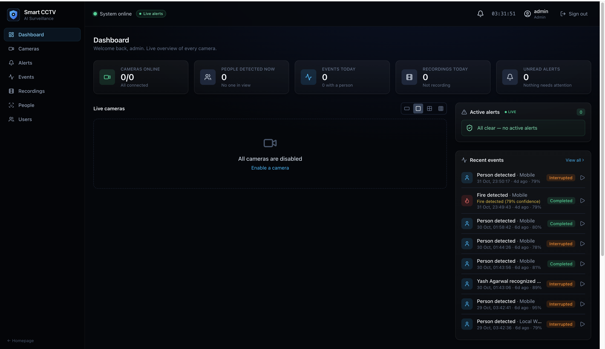
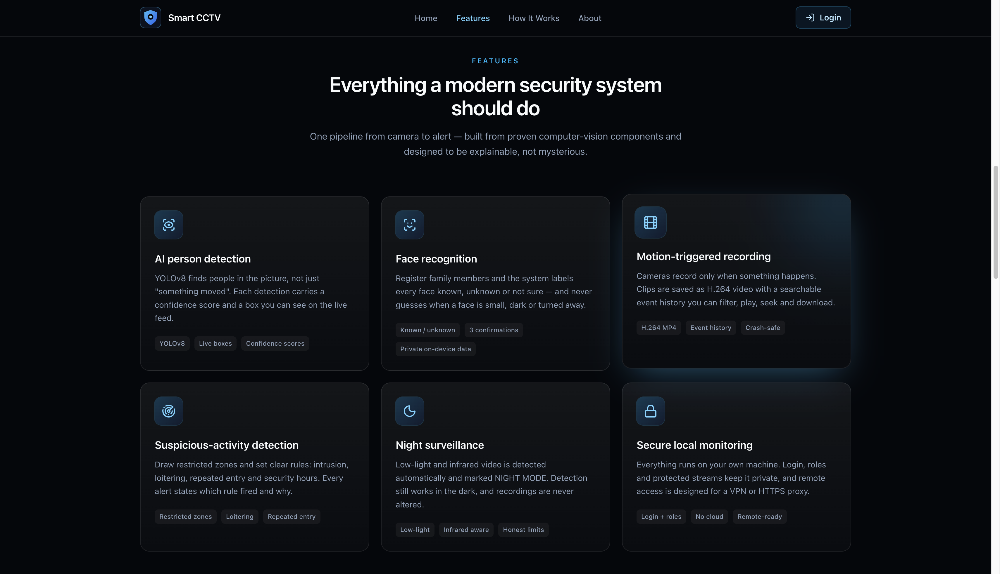
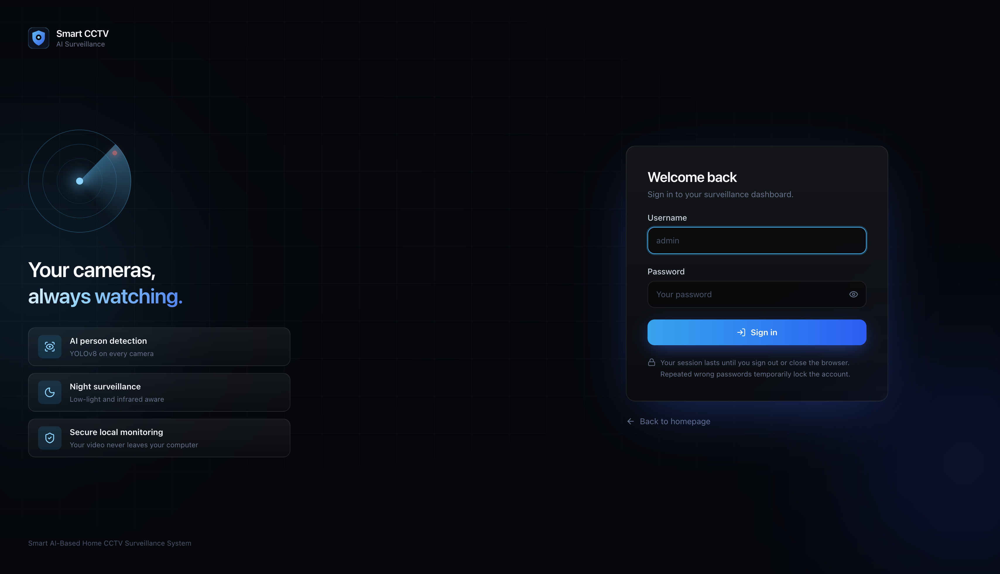

# 🛡️ Smart AI-Based Home CCTV Surveillance System

### Transforming Traditional CCTV Cameras into Intelligent Security Systems

Sentinel AI is an AI-powered home surveillance system designed to make security smarter, faster, and more reliable. It combines computer vision, artificial intelligence, and real-time monitoring to help users monitor their surroundings, recognize important events, and respond to potential security threats.

Unlike traditional CCTV systems that simply record footage, Sentinel AI aims to understand what is happening in front of the camera and provide meaningful insights through intelligent detection and automated alerts.

---

## 📸 Project Screenshots

Explore Sentinel AI through the following application previews.

### 1. Web Page


### 2. Live CCTV Monitoring


### 3. Features


### 4. Login Page


## 🚀 Key Features

- **Real-Time Video Monitoring:** Monitor live video streams using connected cameras and mobile camera feeds.
- **Face Recognition:** Identify and recognize registered faces to support intelligent access monitoring.
- **AI-Based Object Detection:** Detect objects and activities in camera footage using computer vision models.
- **Crowd Detection:** Analyze camera feeds to identify crowded areas and monitor the number of people present.
- **Intelligent Alerts:** Generate notifications when configured detection events or suspicious activities are identified.
- **Night-Time Surveillance:** Support improved monitoring in low-light environments through image enhancement and night-time optimization.
- **Centralized Dashboard:** Access surveillance information and camera monitoring through a unified interface.
- **Backend API:** Manage surveillance operations and communicate between the frontend and AI processing modules.

## 🧠 How It Works

Sentinel AI follows a simple surveillance workflow:

1. **Camera Input:** The system receives live video from a connected camera or mobile camera.
2. **Frame Processing:** Video frames are extracted and prepared for AI analysis.
3. **AI Detection:** Computer vision models analyze frames for supported objects, faces, and activities.
4. **Event Analysis:** Detection results are processed to identify events that may require attention.
5. **Alert Generation:** Relevant events can trigger alerts for the user.
6. **Dashboard Visualization:** Processed information is made available through the application interface.

## 🛠️ Technology Stack

| Component | Technologies |
|---|---|
| Frontend | React.js, JavaScript, CSS |
| Backend | Python, FastAPI |
| Computer Vision | OpenCV |
| AI / ML | Deep Learning and Computer Vision Models |
| API Communication | REST APIs |
| Development | Python Virtual Environment, Node.js, npm |

## 📂 Project Structure

```text
Sentinel-AI/
│
├── backend/
│   ├── app/
│   │   ├── main.py
│   │   ├── routes/
│   │   ├── models/
│   │   └── services/
│   │
│   ├── requirements.txt
│   └── .env.example
│
├── frontend/
│   ├── src/
│   ├── public/
│   ├── package.json
│   └── ...
│
├── .venv/
├── README.md
└── .gitignore
```

*The structure above represents the intended high-level organization. Adjust folder names to match your actual repository.*

## ⚙️ Installation & Setup

Follow these steps to run Sentinel AI locally.

### 1. Clone the Repository

```bash
git clone <YOUR_GITHUB_REPOSITORY_URL>
cd Sentinel-AI
```

### 2. Set Up the Backend

Python 3.12 is recommended.

```bash
python3.12 -m venv .venv
source .venv/bin/activate
```

Install the required dependencies:

```bash
cd backend
python -m pip install --upgrade pip
python -m pip install -r requirements.txt
```

Configure environment variables:

```bash
cp .env.example .env
```

Start the backend server:

```bash
python -m uvicorn app.main:app --reload --port 8000
```

Backend URL:

```text
http://localhost:8000
```

API Documentation:

```text
http://localhost:8000/docs
```

### 3. Set Up the Frontend

Open a new terminal:

```bash
cd frontend
npm install
npm run dev
```

Open the local development URL displayed in your terminal to access the application.

## 🔍 Core Objectives

- Reduce dependence on traditional manual CCTV monitoring.
- Use AI to make surveillance more intelligent and proactive.
- Improve the detection and identification of important events.
- Provide a centralized interface for monitoring and alerts.
- Build a scalable foundation for intelligent home security.

## 🔮 Future Enhancements

The project can be extended with several advanced capabilities:

- **Intrusion Detection:** Identify unauthorized entry into restricted areas.
- **Fire and Smoke Detection:** Detect potential fire-related incidents using computer vision.
- **Advanced Crowd Analytics:** Improve people counting and crowd-density analysis.
- **Suspicious Activity Detection:** Explore activity recognition models for identifying unusual behaviour.
- **Cloud-Based Monitoring:** Enable secure remote access to surveillance data.
- **Mobile Notifications:** Send real-time alerts to users' smartphones.
- **Multi-Camera Support:** Monitor multiple camera feeds simultaneously.
- **Historical Event Analysis:** Maintain searchable records of detected events.

## 🔐 Privacy & Security

Security and privacy are important considerations in any surveillance application.

Sentinel AI is designed with the goal of providing controlled monitoring and responsible handling of surveillance data. Future development can include stronger authentication, encrypted communication, configurable data retention, and access control.

## 🎯 Project Goal

The ultimate goal of Sentinel AI is to move beyond conventional CCTV recording and develop an intelligent surveillance ecosystem that can observe, analyze, and notify users about important events in real time.

**From passive video recording to proactive AI-powered security.**

---

## 👨‍💻 Developed By

**Yash Agarwal**

B.Tech – Computer Science and Engineering (AI)

GitHub: [Your GitHub Profile](https://github.com/yaashaagaarwaal)

---

⭐ If you find this project interesting, consider giving the repository a star!